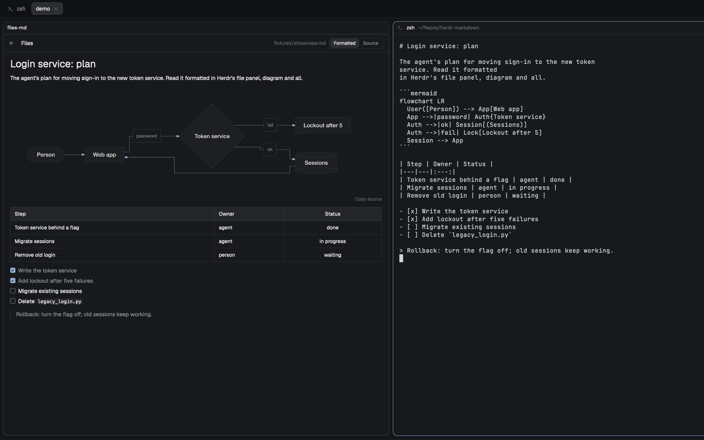

# Live Markdown + Mermaid, for Herdr

Read your agents' Markdown the way it was meant to look, right beside the
terminal: headings, tables, task lists, **Mermaid diagrams** and **images**,
in Herdr's own file panel. It updates as the agent writes.

<picture>
  <source media="(prefers-color-scheme: light)" srcset="preview-light.png">
  
</picture>

[](https://github.com/daneb/herdr-markdown/actions/workflows/gate.yml)

## What you get

- **The file tree you know**, from Herdr's built-in Files panel: your
  terminal's folder, with git marks.
- **Markdown, formatted.** Click a `.md` file and read it, not its source.
  A **Formatted | Source** switch is there when you want the raw text.
- **Diagrams drawn.** Flowcharts, sequence, state, class, ER and XY charts,
  in your theme's colours. Wide ones scroll sideways instead of shrinking
  to nothing.
- **Images shown**, from your project folder: PNG, JPEG, GIF, WebP, SVG, BMP.
- **Links that work.** Web links open your browser; links to other files in
  the folder open in the panel, and **←** takes you back.
- **Live.** When an agent rewrites the file, you see it change.
- **Copy** any text with `⌘C`.

## Install

You need the [Herdr app](https://herdr.dev) 0.1.15 or later, on macOS.

**From Herdr's gallery (recommended).** Find **Live Markdown +
Mermaid** in the [mod gallery](https://herdr.dev/gallery/?type=mods), copy
its line, and give it to an agent running in Herdr. It's this:

> Read ~/.config/herdr-app/AGENTS.md, then add this mod: https://github.com/daneb/herdr-markdown/tree/master

The agent follows Herdr's own instructions: it tells you what the mod runs
and reads before adding it, and asks before adding its suggested key.

**By hand:**

```sh
git clone https://github.com/daneb/herdr-markdown
cd herdr-markdown
./scripts/install.sh
```

This copies one folder, `mods/files-md`, into `~/.config/herdr-app/mods/` and
checks that it loads. Nothing else on your machine changes.

## Open it

From a terminal in Herdr, in the folder you want to browse:

```sh
herdr-app do pane.split '{"direction":"right","mod":"files-md"}'
```

It opens as a pane to the right. Close, resize or zoom it like any pane.

**Prefer a key?** Add this line to the `"global"` section of
`~/.config/herdr-app/keys.json` to open it with `⌘⇧M`:

```json
"cmd-shift-m": { "command": "pane.split", "args": { "direction": "right", "mod": "files-md" } }
```

(Once you edit `keys.json`, Herdr stops updating its default keys for you.
That is Herdr's rule, not ours.)

**Open it on a particular file:**

```sh
herdr-app do pane.split '{"direction":"right","mod":"files-md","props":{"file":"docs/PLAN.md"}}'
```

## Using it

| To | Do |
|---|---|
| Open a folder or file | Click it in the tree |
| See the raw Markdown | Click **Source** in the header (it stays on until you switch back) |
| Follow a link | Click it: web links open your browser, file links open here |
| Go back | Click **←**: back through the files you followed, then to the tree |
| Copy text | Select it, then `⌘C` |
| Copy a diagram's source | Click **Copy source** under the diagram |

A note under the header tells you when something can't be shown, for example
a link outside the folder or an image that's too large.

## Good to know

- **Read-only.** It never changes your files.
- **No network.** Web images are shown as links, not downloaded.
- **Runs nothing new.** The only programs it starts are the ones Herdr's own
  Files panel starts (`sh` to list folders, `git` for status).
- **One folder of its own:** drawn diagrams and copied images are cached in
  `~/.config/herdr-app/data/files-md/`, kept under 100 MB.
- **Diagram types beyond the six above** (gantt, pie, mindmap…) show as
  source, with the reason.
- **Very large files** (over 400,000 characters) open as source.
- **Remote machines:** the tree and text work; images on another machine
  aren't shown.
- Tested on macOS with Herdr 0.1.15 and 0.1.16. Windows and Linux aren't
  tested yet.

Every change is checked automatically for these promises: no network, no new
programs, writes only to its cache. See [docs/QUALITY.md](docs/QUALITY.md).

## Uninstall

Delete two folders, and the key if you added it:

```sh
rm -rf ~/.config/herdr-app/mods/files-md ~/.config/herdr-app/data/files-md
```

## Credits and licence

Apache-2.0. Built on Herdr's own Files panel (Apache-2.0). Diagrams are drawn
by [beautiful-mermaid](https://github.com/lukilabs/beautiful-mermaid) (MIT)
with [elkjs](https://github.com/kieler/elkjs) (EPL-2.0), and the diagram
approach follows [herdr-files-plus](https://github.com/jjongkwann/herdr-files-plus)
(MIT). Details in [NOTICE](NOTICE) and
[THIRD-PARTY-NOTICES](mods/files-md/THIRD-PARTY-NOTICES.md).

Want to build on it or report a problem? See [CONTRIBUTING.md](CONTRIBUTING.md),
or [open an issue](https://github.com/daneb/herdr-markdown/issues).
