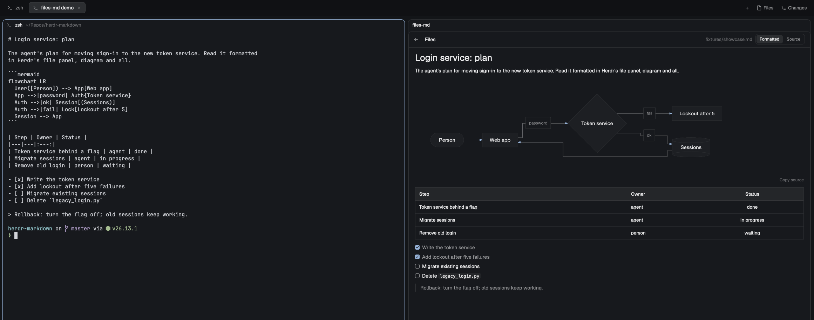

# Files with Markdown (files-md)

Herdr's Files panel as a pane beside your terminal, with Markdown shown
formatted: headings, tables, task lists, Mermaid diagrams drawn in your theme's
colours, and local images in place. Links work inside the folder. The open file
updates as an agent writes it. Read-only, no network.

## What you see

A pane to the right of the focused terminal, framed like any pane in your
layout, under Herdr's pane header (which names it "files-md"). Inside it, the shipped Files
panel's card: 10 px corners, a 1 px `border` edge, `background` fill, 13 px UI
text in `foreground`.

- **Header, 42 px**, 14 px side padding, 8 px gaps: a `←` (20 px wide,
  `muted`) while a file is open; "Files" in semibold; the folder's name, or
  the open file's path, right-aligned in 12 px `dim`. While a Markdown file is
  open, a two-part switch sits at the right end: **Formatted | Source**, 11 px
  text, each part 22 px tall with 8 px side padding and 5 px corners, the
  chosen part on `selected` in `foreground`, the other in `muted` with a
  `hover` background; around both, a 1 px `border` with 7 px corners and 2 px
  padding.
- **Message line**, only when there is something to say: 12 px `dim` text
  with 14 px side and 6 px vertical padding and a `border` line under it ("Not
  followed: outside this folder (../../etc/passwd)", "Copied
  someone@example.com", "Over 400,000 characters · showing source").
- **The tree**, as shipped: 28 px rows, a chevron and a folder or file icon,
  git marks A, M, D, U on the right.
- **A formatted file**: 16 px side and 12 px vertical padding, 13 px text,
  scrolling. Code blocks get a box and a language label (no syntax colours).
  Task lists show checkboxes. Front matter shows as a `yaml` code block.
- **With diagrams or images**, the file becomes one scrolling column with
  10 px gaps between text, diagrams and pictures:
  - A diagram is drawn at its own size, shrunk to the column's width but
    never below 60%; a wider one scrolls sideways in its own strip. Under it,
    right-aligned, "Copy source" in 11 px `dim` (`foreground` on hover), then
    "Copied".
  - While one is drawing: a box (10 px padding, 6 px corners, 1 px `border`)
    with "Drawing diagram…" or "Loading image…" in 12 px `dim`.
  - A diagram that cannot be drawn: one 12 px `dim` line, "Diagram not drawn:
    Invalid mermaid header: "gantt"…", then its source as a code block.
  - An image that is not shown: the same box with its alt text and why:
    "“badge” · Web image · not loaded" with the address under it in `ansi4`,
    or "Not found", "Over 10 MB · not shown", "Not a PNG, JPEG, GIF, WebP, SVG
    or BMP image", "Outside this folder · not shown", "Embedded image · not
    shown", "Image on another machine · not shown".
- **Empty file**: "Empty file" in `dim`.

## How it behaves

- **Opening it**: `herdr-app do pane.split '{"direction":"right","mod":"files-md"}'`,
  or the suggested key `cmd-shift-m` once merged into `keys.json`. With
  `"props": {"file": "docs/PLAN.md"}` it opens that file first (relative to the
  terminal's folder; a path outside it is ignored). It closes,
  zooms, resizes and moves like any pane, and works in Herdr's shipped
  layouts. Herdr keeps a mod pane alive with its tab, so its file and mode
  survive a layout switch.
- **Which folder**: the focused terminal's, as the shipped panel. Clicking
  into the panel does not move the tree: it keeps the last terminal's folder
  (with none yet, the tab's first terminal's, else the space's).
- **Click** a folder to open or close it, a file to open it. `.md`,
  `.markdown` and `.mdx` (any case) open Formatted; everything else opens in
  the shipped read-only source view.
- **Formatted | Source** switches the open file; the choice holds for every
  file until the pane closes.
- **Select and copy** with `cmd-c` in formatted text. Diagrams and images are
  pictures, so a selection stops at them.
- **Links**: `http`/`https` open the browser. `mailto` copies the address
  (the app opens only web addresses). A link to a file inside the folder opens
  it in the panel, dropping any `#anchor`; `←` walks back through the files
  you came from, then to the tree. Links outside the folder, to missing files,
  to other schemes, and links within the same file are refused with a message.
- **Live**: while a file is open formatted, it is read again when anything
  in the folder changes (on another machine: every 10 seconds). Unchanged
  diagrams and images are not redrawn; a changed image is. A deleted file says
  "This file is no longer available" and comes back if the file does. A file
  in Source is not re-read.
- **Limits**: over 400,000 characters opens in Source with a message. 50
  diagrams and 50 images per file, 20,000 characters per diagram, 10 MB per
  image; past these, each says why. The tree keeps the shipped 500 per folder
  and 5,000 in all.
- **Diagram types**: flowchart (`graph`, `flowchart`), sequence, state,
  class, ER and XY chart. Others (gantt, pie, mindmap, C4, …) show as source
  with the renderer's reason. The renderer is lenient: some broken syntax
  still draws, partly.
- **Images**: `` with a path inside the folder, on this computer:
  PNG, JPEG, GIF, WebP, SVG, BMP. Web images are not fetched. In a table row,
  or written by reference (`![alt][ref]`), an image shows as "[image: alt]".
  An SVG with scripts, embedded HTML or outside links is refused.
- **Theme**: switching theme redraws diagrams in the new colours.

## Built from

- `mods/files-md/` is a clone of Herdr's shipped `files` mod, app 0.1.15
  (`herdr-app do mod.clone '{"name":"files","as":"files-md"}'`). `mod.json`:
  `{"place": "none", "title": "Files", "cloned_from": {...}}`.
- `main.js`, the clone, changed (about 160 lines): imports `TextView`,
  `appHome` and `fs/promises`; `location()` uses `pickLocation`; `show()`
  keeps the text and calls `present()`, which chooses Formatted, Source or
  Empty and builds the source editor only for Source; a header switch
  (`modeSwitch`); `formatted()` draws one `TextView.markdown(...).selectable(true)
  .scrollable(true)`; `follow()` handles link clicks, `back()` walks the
  history; `reread()` runs from the watch (with the changed paths) and the
  10-second timer; `init` binds `cmd-c`.
- `lib.js`: `isMarkdown`, `frontMatterAsCode`, `chooseView`, `pickLocation`,
  `resolvePath`, `classifyLink`, `resolveImage`, `imageKind` (from the first
  bytes), `imageSize` (from each format's header).
- `mermaid.js`: `splitDocument` (one pass over the lines, following every
  fence, into text, `mermaid` and image parts), `colorsFor`, `flattenSvg`,
  `unsafeSvg`, `diagramName`, `renderDiagram` (loads the bundle with
  `import("./mermaid.bundle.js")` on the first diagram).
- `pictures.js`: draws parts one at a time in `cx.spawn` and lays out the
  column; `cache.js`: the cache.
- `mermaid.bundle.js`: beautiful-mermaid 1.1.3 with elkjs 0.11.1 and entities,
  built by `scripts/build-mermaid.mjs` (esbuild, ESM, minified, about 1.56 MB).
- Diagram colours from `theme()`: `bg` background, `fg` foreground, `line`
  dim, `accent` ansi4, `muted` muted, `border` border, each made solid over
  the background. Font: `'Helvetica Neue', 'Segoe UI', Arial, 'Noto Sans',
  sans-serif`; transparent background.
- `herdr`: `spaces`, `panes`, `focused`, `exec`, `readTextFile`, `watchFolder`,
  `theme`, `settings`, `window`, `appHome`. Context: `cx.bind_keys`,
  `cx.open_url`, `cx.write_to_clipboard`.
- Programs: only the shipped panel's (`sh` or PowerShell to list a folder,
  `git` for marks). No network. Writes only to
  `~/.config/herdr-app/data/files-md/`.
- `keys.json` (beside the mod folder):
  `{"global": {"cmd-shift-m": {"command": "pane.split", "args": {"direction": "right", "mod": "files-md"}}}}`.

## Watch out

- **`"place": "right"` does not dock** into Herdr's shipped layouts (nothing
  happens, no error). Open it as a pane instead.
- **`cmd-c` does nothing** in a selectable `TextView` unless bound:
  `cx.bind_keys([{ keystroke: "cmd-c", action: "input::Copy", context: "TextView" }])`.
  `bind_keys` accepts any action name without checking it. From Herdr 0.1.16
  the text view answers `shell_root::Copy` instead, so `input::Copy` arrives
  unhandled: catch it on the panel's root with
  `.on_action("input::Copy", () => globalThis.window.dispatch_action("shell_root::Copy"))`
  (`globalThis.window` is GPUI's; the `window` imported from `herdr` is not).
- **`TextView.markdown` drops images** entirely, alt text included; draw them
  yourself.
- **`image()` reads only the app's home**: copy images and diagrams into
  `data/files-md/` first. Name copies by content, or a changed file keeps its
  old picture.
- **The runtime's `fs` has no `stat`**: `cache.js` keeps `index.json` (size,
  last use) to stay under 100 MB, and deletes only names it made. Images are
  read before their size is known.
- **`on_size_change` reports zoomed pixels; `.w()` takes sizes at zoom 1.**
  Divide by `settings().zoom`, or diagrams are cut off at the right.
- **Theme colours may carry alpha** (`border` is `#ffffff18`): make them
  solid before giving them to the renderer, or borders come out white.
- **Mermaid's own library cannot run here** (no DOM). beautiful-mermaid can,
  but elkjs needs four build-time patches (frozen prototypes, no `window`,
  `setTimeout` throws); each must apply exactly once. Its SVG uses CSS
  variables, `color-mix()` and a web-font `@import`, none of which the SVG
  loader handles: `flattenSvg` resolves them.
- **Drawing is synchronous**: a 40-node flowchart takes about 300 ms in
  QuickJS and the window waits. Limits are on size, not time.
- **A symlink inside the folder that points outside it is followed**, as in
  the shipped tree.
- **On Herdr 0.1.15, `herdr-app shot` returned a stale frame** while the window
  was covered. 0.1.16 fixed this; `scripts/shots.sh` still brings Herdr forward.
- **Licences**: the clone is Apache-2.0; elkjs is EPL-2.0 and patched, so its
  patched source ships in the repository's `vendor/` and its notices stay in
  the bundle. See `mods/files-md/THIRD-PARTY-NOTICES.md`.
- Tested on Herdr 0.1.15 and 0.1.16 (macOS). The shipped `files` mod is
  identical in both.
- Windows and Linux paths are kept from the shipped mod but untested.

## Done when

- `herdr-app check ~/.config/herdr-app/mods/files-md` passes, and `npm run ci`
  passes (71 tests and the 16 gate checks).
- `scripts/shots.sh <theme>` gives ten shots, each showing its fixture.
- `pane.split {direction: "right", mod: "files-md"}` opens it in the shipped
  `main` layout, showing the focused terminal's folder with git marks;
  clicking inside it leaves the tree where it is.
- `fixtures/basics.md`, `tables.md`, `tasks.md` open formatted; a `.json`
  opens as source; Source then another Markdown file opens as Source.
- `cmd-c` copies a selected paragraph.
- `fixtures/mermaid.md`: six diagram types drawn in theme colours; `gantt`
  shows its source and reason; the nested fence stays code. Switching theme
  redraws them.
- `fixtures/architecture.md`: drawn at 60%, scrolls sideways.
- `fixtures/images.md`: every local format drawn; each other case says why.
- `fixtures/links.md`: each link does what "How it behaves" says; `←` walks
  back.
- Appending to `fixtures/live.md` from a terminal shows the new line in the
  open file without a click; its diagram does not flash.
- `fixtures/huge.md` opens in Source with the 400,000-character message;
  `empty.md` says "Empty file".
