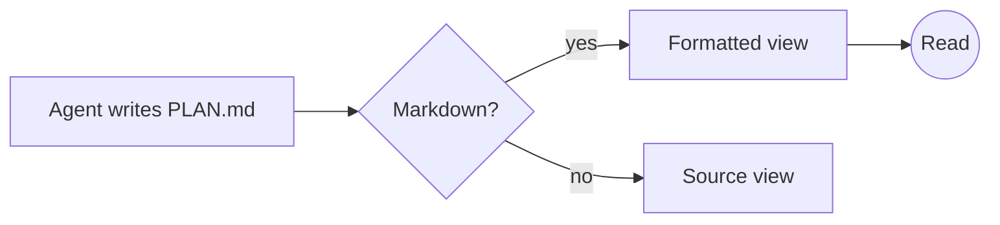
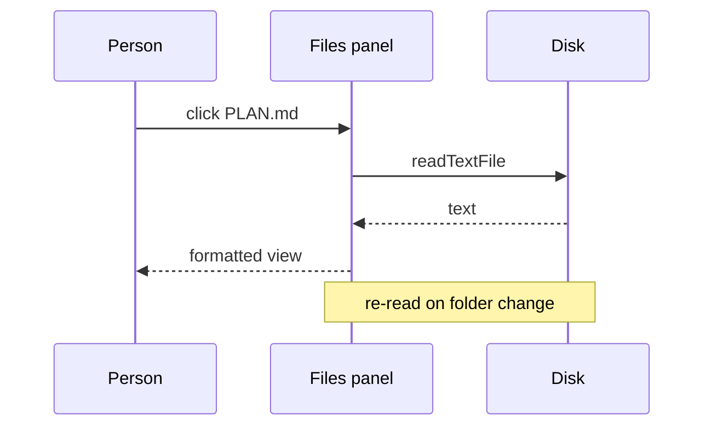
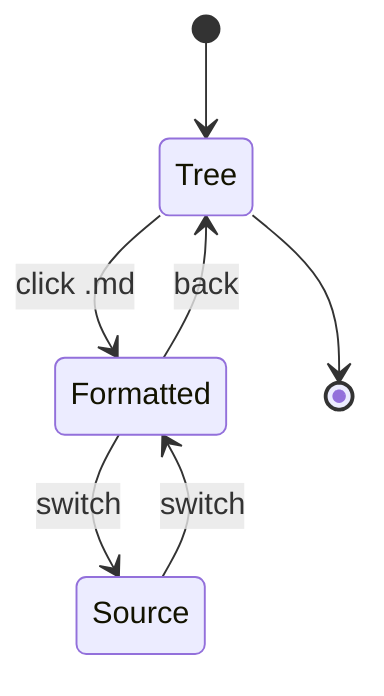
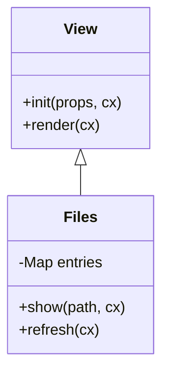
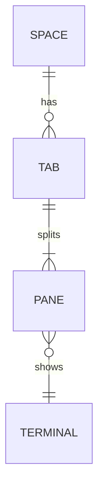
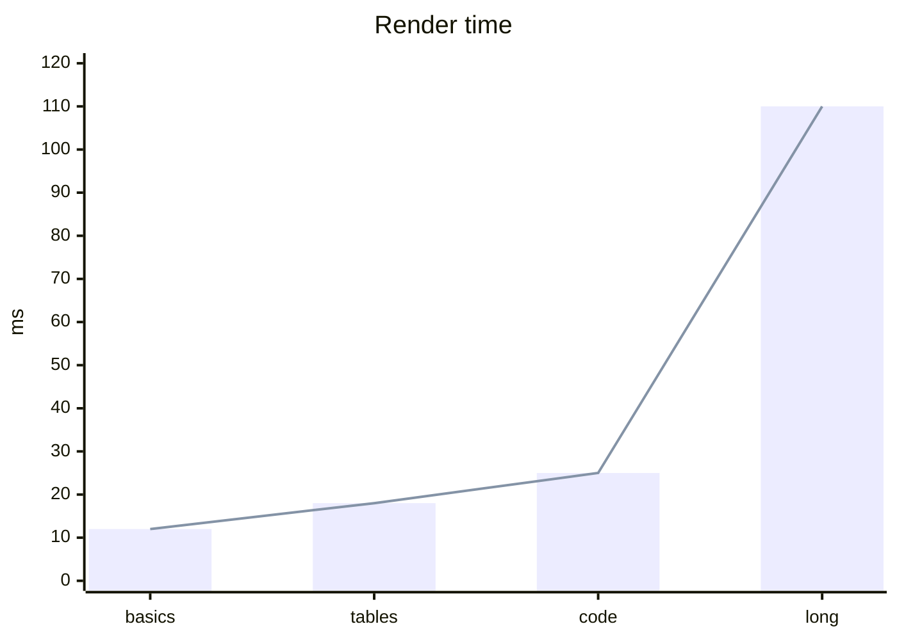
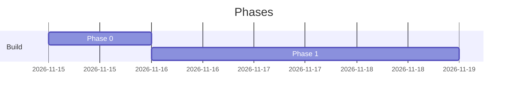
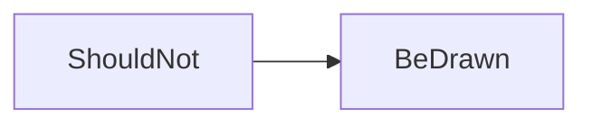

# Mermaid

## Flowchart



## Sequence



## State



## Class



## ER



## XY chart



## Unsupported type (falls back to source)



## Syntax error (falls back to source)

```mermaid
flowchart LR
  A -->
  --> B [[[
```

## A mermaid fence inside a longer fence stays code

````markdown

````

## Tilde fence

~~~mermaid
flowchart TD
  Tilde --> Works
~~~

## Indented fence in a list

1. A step with a diagram:

   ```mermaid
   flowchart LR
     Indented --> Fence
   ```

2. The next step.

## Unclosed fence (stays Markdown to the end)

```mermaid
flowchart LR
  Never --> Closed
