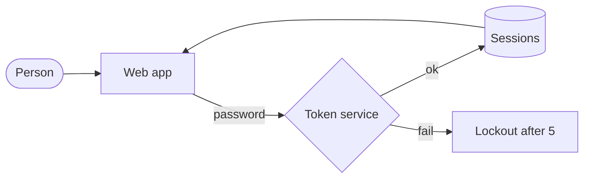

# Login service: plan

The agent's plan for moving sign-in to the new token service. Read it formatted
in Herdr's file panel, diagram and all.

| Step | Owner | Status |
|---|---|:---:|
| Token service behind a flag | agent | done |
| Migrate sessions | agent | in progress |
| Remove old login | person | waiting |

- [x] Write the token service
- [x] Add lockout after five failures
- [ ] Migrate existing sessions
- [ ] Delete `legacy_login.py`

> Rollback: turn the flag off; old sessions keep working.
